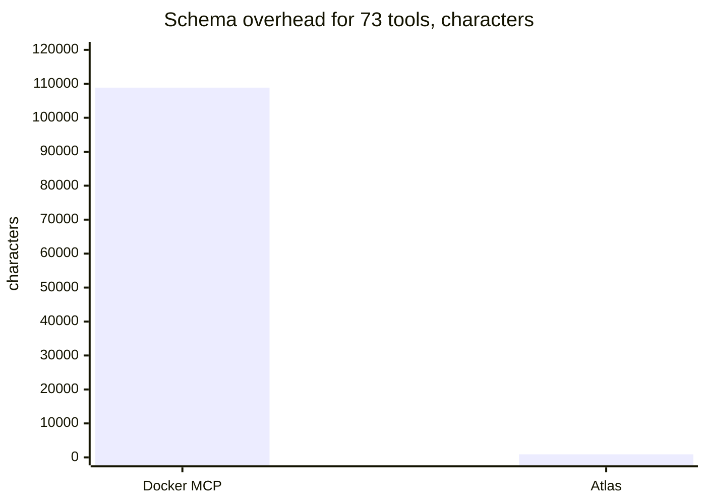
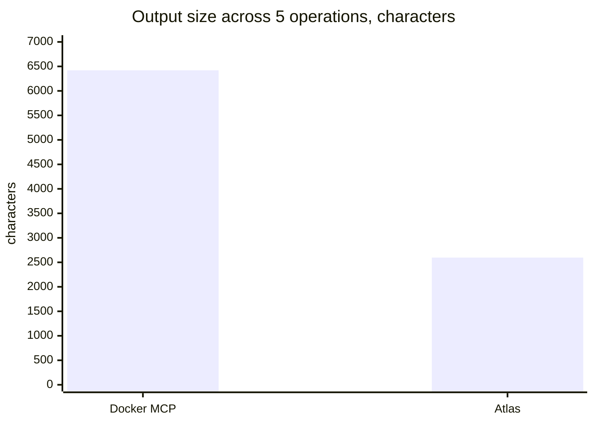
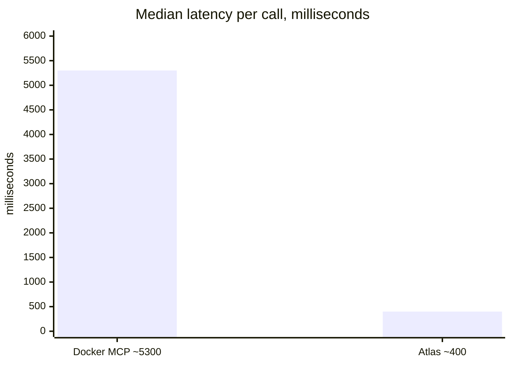

# atlas

Faster Jira and Confluence for AI coding agents.

- **121x less context** -- one routing rule replaces 73 MCP tool schemas
- **60% smaller output** -- flat Markdown, not nested JSON
- **12x faster** -- direct HTTP in ~400 ms vs ~5,300 ms per Docker MCP call

## Why atlas?

In agent workflows, Docker-based MCP servers impose hidden costs: tool schemas that bloat context, verbose JSON output, and container overhead on every call. Atlas CLI eliminates all three. Measurements below were taken against live Atlassian Cloud APIs.



Atlas is the short bar: **901** characters against **108,867**.





| Dimension | Docker MCP | Atlas CLI | Improvement | Details |
|-----------|-----------|-----------|-------------|---------|
| Schema overhead (73 tools) | 108,867 chars (~27,216 tokens) | 901 chars (~225 tokens) | **121x smaller** | [benchmarks/SCHEMA.md](benchmarks/SCHEMA.md) |
| Output size (5-op total) | 6,421 chars (~1,605 tokens) | 2,597 chars (~649 tokens) | **60% smaller** | [benchmarks/OUTPUT.md](benchmarks/OUTPUT.md) |
| Latency (per call median) | ~5,300 ms | ~400 ms | **12.8x faster** | [benchmarks/LATENCY.md](benchmarks/LATENCY.md) |

> **Scope**: These benchmarks compare Atlas CLI against **Docker MCP** (ephemeral containers). Not all MCP servers use Docker — HTTP and stdio MCP servers run as persistent processes with negligible per-call overhead. For persistent MCP servers, the latency tradeoff can reverse because Cursor's Shell tool sandbox adds ~1.6–2 s per CLI invocation that `CallMcpTool` avoids. Atlas CLI still wins on schema overhead and output size regardless of MCP transport. See [benchmarks/LATENCY.md — Scope and Limitations](benchmarks/LATENCY.md#scope-and-limitations) for details.

### See the difference

The same issue fetched through Docker MCP vs Atlas CLI — full comparison with raw API output (27,788 chars for the same issue) in [benchmarks/OUTPUT.md](benchmarks/OUTPUT.md).

### Schema overhead -- 121x reduction

Enabling Docker MCP injects ~1,500 tokens of infrastructure (wrapper tools, server metadata, usage instructions) into **every turn**, whether or not you call an Atlassian tool. On top of that, each new MCP tool call triggers a schema read (~370 tokens on average) that **stays in conversation history** for all subsequent turns.

Atlas CLI replaces 73 Atlassian tool schemas (108,867 chars) with a single 901-char routing rule -- a **121x reduction**. Over a 20-turn session with 10 Atlassian calls, this saves ~47,000 tokens of context. Details in [benchmarks/SCHEMA.md](benchmarks/SCHEMA.md).

### Output size -- 60% fewer tokens

Docker MCP returns nested JSON containing avatar URLs, null custom fields, status metadata, and ADF document trees. Atlas emits flat Markdown with only the fields the model needs.

Across 5 representative operations, Atlas produces **2,597 chars (~649 tokens)** vs Docker MCP's **6,421 chars (~1,605 tokens)** -- a **60% reduction**. Compared to the raw Atlassian API (41,567 chars), the savings reach **96%**. Details in [benchmarks/OUTPUT.md](benchmarks/OUTPUT.md).

### Execution latency -- 12x faster

Docker MCP creates an ephemeral container for every tool call, adding ~4,500 ms of container lifecycle overhead (create, start, teardown). Atlas runs as a local subprocess that starts in ~80 ms and makes a direct HTTP request.

Median per-call latency drops from **~5,300 ms to ~400 ms** -- a **12.8x speedup**. Over a 10-call session, that is **~49 seconds saved** in pure execution time. Details in [benchmarks/LATENCY.md](benchmarks/LATENCY.md).

## Quick Start

### Prerequisites

- [uv](https://docs.astral.sh/uv/) — install with:
  - macOS/Linux: `curl -LsSf https://astral.sh/uv/install.sh | sh`
  - Windows (PowerShell): `powershell -ExecutionPolicy ByPass -c "irm https://astral.sh/uv/install.ps1 | iex"`
- An [Atlassian API token](https://id.atlassian.com/manage-profile/security/api-tokens)

uv downloads a Python 3.10+ for the tool, so a separate Python install is not required.

### 1. Install

```bash
uv tool install atlassian-atlas
```

Close and reopen your terminal if `atlas` is not found. The command is installed to `~/.local/bin`.

To try it without installing: `uvx atlassian-atlas --help`

Without uv, use pipx: `pipx install atlassian-atlas`

Verify: `atlas --help`

<details>
<summary><strong>Install from source</strong></summary>

This builds the default branch rather than a release. Use it to try unreleased changes.

```bash
uv tool install git+https://github.com/edison-cc/atlas.git
```

Or clone and install into the current environment:

```bash
git clone https://github.com/edison-cc/atlas.git
cd atlas
uv pip install .
```

Without uv, use `pip install .` in a virtual environment. That path needs Python 3.10+.

</details>

### 2. Configure Atlassian credentials

Create `~/.config/atlas/config.json`:

```json
{
  "atlassian_email": "you@example.com",
  "atlassian_api_token": "your-api-token",
  "atlassian_base_url": "https://your-site.atlassian.net/",
  "story_points_field": "",
  "acceptance_criteria_field": ""
}
```

Generate a token at https://id.atlassian.com/manage-profile/security/api-tokens

> **Tip:** You can use environment variables instead of a config file: `ATLASSIAN_EMAIL`, `ATLASSIAN_API_TOKEN`, `ATLASSIAN_BASE_URL`.
>
> Create a **classic** API token ("Create API token", not "Create API token with scopes"). Atlas sends that token to your site URL. A scoped token only works against `api.atlassian.com` and is rejected here.
>
> Jira and Confluence must both be on this site. Atlas calls Jira at `/rest/api/3` and Confluence at `/wiki/rest/api` on `atlassian_base_url`.
>
> **Story points or acceptance criteria?** Field ids differ by site, and a blank value leaves the feature off. Discover them with `atlas jira fields --search "story"` or `atlas jira fields --search "acceptance"`, then set `story_points_field` and `acceptance_criteria_field`. Until then, `--story-points` is skipped and `--ac` exits with an error.

### Upgrade

```bash
uv tool upgrade atlassian-atlas
```

If you installed with pipx: `pipx upgrade atlassian-atlas`

<details>
<summary><strong>Windows notes</strong></summary>

PowerShell is enough. After the uv installer and `uv tool install`, close and reopen the terminal so `PATH` changes take effect.

The config template is [config.json.example](https://raw.githubusercontent.com/edison-cc/atlas/main/config.json.example). In PowerShell, download it with `Invoke-WebRequest`.

</details>

## Coding agents

Atlas is a shell command. An agent that can run a terminal can use it. Put the instruction below in the file that agent already reads, and commit it if the whole team should follow it.

[AGENTS.md](https://agents.md/) at the project root is the shared file. Codex, GitHub Copilot, Cursor, and Claude Code (when the repo has no `CLAUDE.md`) load it.

```markdown
## Atlassian

Use the `atlas` CLI for every Jira and Confluence operation. Do not call an Atlassian MCP server.

Discover flags with `atlas jira --help` and `atlas conf --help`. A Jira search needs a restriction, such as a project clause. `--ac` and `--story-points` need `acceptance_criteria_field` and `story_points_field` in the atlas config. Discover the ids with `atlas jira fields --search`.
```

Some agents look for their own file first:

| Agent | Where to put the same instruction |
|---|---|
| Claude Code | `CLAUDE.md`. If that file already exists, add a line `@AGENTS.md` so it still loads the shared instructions. |
| Gemini CLI | `GEMINI.md`, or add `AGENTS.md` to `context.fileName` in `.gemini/settings.json`. |
| GitHub Copilot | `AGENTS.md`, or [`.github/copilot-instructions.md`](.github/copilot-instructions.md). This repo ships a copy you can reuse. |
| Cursor | `AGENTS.md`. |

<details>
<summary><strong>Copy the Copilot instruction file</strong></summary>

```bash
mkdir -p .github
curl -fsSL https://raw.githubusercontent.com/edison-cc/atlas/main/.github/copilot-instructions.md \
  -o .github/copilot-instructions.md
```

</details>

## CLI reference

Atlas also works as a standalone terminal CLI without any editor integration.

### Jira

Jira rejects a search with no restriction, such as `order by created DESC`. Include a project, updated date, or other clause.

```bash
atlas jira get PROJ-123  # issue details
atlas jira get PROJ-123 --comments  # with comments
atlas jira search "project = PROJ AND status = Open"  # JQL search
atlas jira search "parent = PROJ-100" --story-points --parent  # extra columns
atlas jira children PROJ-100 --story-points  # recursive
atlas jira children PROJ-100 --depth 3 --limit 200  # deeper traversal
atlas jira parent PROJ-123  # ancestor chain
atlas jira fields --search "story"  # discover field IDs
atlas jira create --project PROJ --type Story --summary "Add feature X" --parent PROJ-100 --ac "- criterion 1"
atlas jira update PROJ-123 --summary "New title" --ac "- updated criterion"
atlas jira comment PROJ-123 "This is a comment"
atlas jira transitions PROJ-123  # list available
atlas jira transition PROJ-123 31  # move to status
atlas jira create --help  # discover all flags
```

### Confluence

```bash
atlas conf get 12345678  # page content
atlas conf search "architecture" --space DEV  # search
atlas conf tree DEV  # page hierarchy
atlas conf create --space DEV --title "New Page" --body "content"
atlas conf update 12345678 --title "Updated" --body "new content"
atlas conf publish 12345678 doc.md --title "Design Doc"  # publish with Mermaid
atlas conf --help  # list commands
```

## Adding commands

Each command is a single file in `atlas/commands/`. Create a new file with `register(subparser)` and `run(args, client)` functions — it's auto-discovered.

## License

[MIT](LICENSE)
