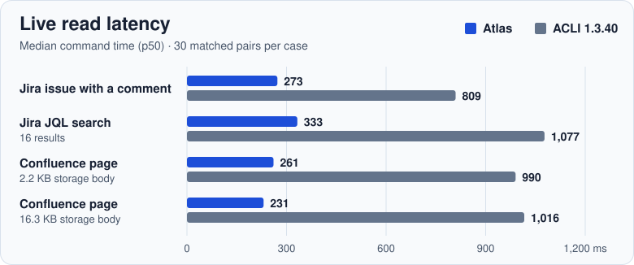

# atlas

Compact Jira and Confluence CLI for terminals and AI coding agents.

- Read issues, search projects, and browse Confluence from your terminal.
- Get compact Markdown output for supported operations.
- Use the same commands manually or through an agent's shell tool.

## Why atlas?

Use Atlas to read a Jira issue in your terminal, keep the design document in Git,
and publish the document and its Mermaid diagrams to Confluence. Atlas calls
Atlassian Cloud REST APIs directly.

After setup, run `atlas jira get PROJ-123` with your issue key. Save this
example as `design.md` and install [Mermaid CLI](https://github.com/mermaid-js/mermaid-cli)
to try the publish preview.

````markdown
# Design

The worker reads jobs from the queue.


````

```bash
atlas conf publish 12345678 design.md --title "Design" --dry-run
```

The preview shows the page ID, rendered attachment name, and converted page
body. To publish, use an existing Confluence page ID and omit `--dry-run`.

### Atlas vs. Atlassian CLI

In seven matched live Jira read cases, Atlas had **63–69% lower median latency**
and **33–59% fewer JSON stdout bytes** than ACLI 1.3.40. In two matched
Confluence page reads, Atlas had **74–77% lower median latency** and **29–38%
fewer JSON stdout bytes**. Each case had 30 matched pairs on the same Mac and
Atlassian Cloud site. Atlas used an API token and ACLI used OAuth.

[](benchmarks/ACLI.md)

<details>
<summary>View exact p50 and p95 values for the charted cases</summary>

| Workload | Atlas p50 / p95 | ACLI p50 / p95 |
| --- | ---: | ---: |
| Jira issue with a comment | 273 / 315 ms | 809 / 926 ms |
| Jira JQL search, 16 rows | 333 / 407 ms | 1,077 / 1,269 ms |
| Confluence page, 2.2 KB storage body | 261 / 326 ms | 990 / 1,153 ms |
| Confluence page, 16.3 KB storage body | 231 / 285 ms | 1,016 / 1,188 ms |

</details>

ACLI covers more Jira and Confluence operations in its visible command tree
(70 command names versus 16), including Jira bulk actions and Confluence
space and blog management. Atlas provides dedicated Jira hierarchy commands
and a one-command Markdown and Mermaid publishing workflow for Confluence.
See the [full comparison and raw samples](benchmarks/ACLI.md) and the
[benchmark protocol](benchmarks/README.md).

## Quick Start

### Prerequisites

- [uv](https://docs.astral.sh/uv/) — install with:
  - macOS/Linux: `curl -LsSf https://astral.sh/uv/install.sh | sh`
  - Windows (PowerShell): `powershell -ExecutionPolicy ByPass -c "irm https://astral.sh/uv/install.ps1 | iex"`
- An [Atlassian API token](https://id.atlassian.com/manage-profile/security/api-tokens)

uv downloads a Python 3.10+ for the tool, so a separate Python install is not required.

### 1. Install

```bash
uv tool install atlassian-atlas
```

If `atlas` is not found, run `uv tool update-shell`, then restart your terminal.

To try it without installing: `uvx --from atlassian-atlas atlas --help`

Without uv, use pipx: `pipx install atlassian-atlas`

Verify: `atlas --help`

<details>
<summary><strong>Install from source</strong></summary>

This builds the default branch rather than a release. Use it to try unreleased changes.

```bash
uv tool install git+https://github.com/edison-cc/atlas.git
```

Or clone and install into the current environment:

```bash
git clone https://github.com/edison-cc/atlas.git
cd atlas
uv venv
uv pip install .
uv run atlas --help
```

Without uv, use `pip install .` in a virtual environment. That path needs Python 3.10+.

</details>

### 2. Configure Atlassian credentials

On macOS/Linux, create the directory with `mkdir -p ~/.config/atlas`.
On PowerShell, use `New-Item -ItemType Directory -Force "$HOME/.config/atlas"`.
Then create `~/.config/atlas/config.json`:

```json
{
  "atlassian_email": "you@example.com",
  "atlassian_api_token": "your-api-token",
  "atlassian_base_url": "https://your-site.atlassian.net/",
  "story_points_field": "",
  "acceptance_criteria_field": ""
}
```

Generate a token at https://id.atlassian.com/manage-profile/security/api-tokens

> **Tip:** You can use environment variables instead of a config file: `ATLASSIAN_EMAIL`, `ATLASSIAN_API_TOKEN`, `ATLASSIAN_BASE_URL`.
>
> Create a **classic** API token ("Create API token", not "Create API token with scopes"). Atlas sends that token to your site URL. A scoped token only works against `api.atlassian.com` and is rejected here.
>
> Jira and Confluence must both be on this site. Atlas calls Jira at `/rest/api/3` and Confluence at `/wiki/rest/api` on `atlassian_base_url`.
>
> **Story points or acceptance criteria?** Field ids differ by site, and a blank value leaves the feature off. Discover them with `atlas jira fields --search "story"` or `atlas jira fields --search "acceptance"`, then set `story_points_field` and `acceptance_criteria_field`. Until then, `--story-points` is skipped and `--ac` exits with an error.

### 3. Try a read-only operation

Replace `PROJ-123` with an issue you can access:

```bash
atlas jira get PROJ-123
```

A successful response contains the issue key, summary, and Markdown details. For
Confluence, use `atlas conf get <PAGE-ID> --format storage` when you need the
original storage markup; the default readable conversion is best-effort.

### Upgrade

```bash
uv tool upgrade atlassian-atlas
```

If you installed with pipx: `pipx upgrade atlassian-atlas`

<details>
<summary><strong>Windows notes</strong></summary>

PowerShell is enough. After the uv installer and `uv tool install`, close and reopen the terminal so `PATH` changes take effect.

The config template is [config.json.example](https://raw.githubusercontent.com/edison-cc/atlas/main/config.json.example). In PowerShell, download it with `Invoke-WebRequest`.

</details>

## Coding agents

Atlas is a shell command. An agent that can run a terminal can use it. Put the instruction below in the file that agent already reads, and commit it if the whole team should follow it.

[AGENTS.md](https://agents.md/) at the project root is the shared file. Codex, GitHub Copilot, Cursor, and Claude Code (when the repo has no `CLAUDE.md`) load it.

```markdown
## Atlassian

Use the `atlas` CLI for every Jira and Confluence operation. Do not call an Atlassian MCP server.

Discover commands with `atlas jira --help` and `atlas conf --help`, then inspect flags with subcommand help such as `atlas jira get --help`. A Jira search needs a restriction, such as a project clause. `--ac` and `--story-points` need `acceptance_criteria_field` and `story_points_field` in the atlas config. Discover the ids with `atlas jira fields --search "story"` or `atlas jira fields --search "acceptance"`.
```

Some agents look for their own file first:

| Agent | Where to put the same instruction |
|---|---|
| Claude Code | `CLAUDE.md`. If that file already exists, add a line `@AGENTS.md` so it still loads the shared instructions. |
| Gemini CLI | `GEMINI.md`, or add `AGENTS.md` to `context.fileName` in `.gemini/settings.json`. |
| GitHub Copilot | `AGENTS.md`, or [`.github/copilot-instructions.md`](.github/copilot-instructions.md). This repo ships a copy you can reuse. |
| Cursor | `AGENTS.md`. |

<details>
<summary><strong>Copy the Copilot instruction file</strong></summary>

```bash
mkdir -p .github
curl -fsSL https://raw.githubusercontent.com/edison-cc/atlas/main/.github/copilot-instructions.md \
  -o .github/copilot-instructions.md
```

</details>

## CLI reference

Atlas also works as a standalone terminal CLI without any editor integration.

Add `--json` to Jira `get` and `search`, or Confluence `get`, `search`, and
`tree`, to get a single JSON object with `schema_version: 1`. Jira JSON preserves
the values returned for the requested fields, including custom fields. Searches
include `items` and `pagination` with `returned`, `total` (null when unknown),
and `has_more`. Confluence `get --json --format storage` puts the original
markup in `body.value`. Tree JSON applies `--depth` to `roots` and `detached`,
and reports the number of pages loaded as `fetched_count`.

### Jira

Jira rejects a search with no restriction, such as `order by created DESC`. Include a project, updated date, or other clause.
Search returns one page by default and shows whether more results are available.
Use `jira search --paginate` to follow all pages. With `--paginate`, an explicit
`--limit N` caps the total returned across pages. For `jira children`, `--limit`
sets the requested page size, and Atlas follows every page at each requested depth.

```bash
atlas jira get PROJ-123  # issue details
atlas jira get PROJ-123 --comments  # with comments
atlas jira search "project = PROJ AND status = Open"  # JQL search
atlas jira search "project = PROJ ORDER BY key ASC" --paginate --json
atlas jira search "parent = PROJ-100" --story-points --parent  # extra columns
atlas jira children PROJ-100 --story-points  # recursive
atlas jira children PROJ-100 --depth 3 --limit 200  # deeper traversal
atlas jira parent PROJ-123  # ancestor chain
atlas jira fields --search "story"  # discover field IDs
atlas jira create --project PROJ --type Story --summary "Add feature X" --parent PROJ-100 --ac "- criterion 1"
atlas jira update PROJ-123 --summary "New title" --ac "- updated criterion"
atlas jira comment PROJ-123 "This is a comment"
atlas jira transitions PROJ-123  # list available
atlas jira transition PROJ-123 31  # move to status
atlas jira create --help  # discover all flags
```

### Confluence

Page reads preserve code blocks, links, and table cells in the default Markdown
output. Tables with merged cells remain HTML. The page tree follows pagination
before organizing pages by parent.

```bash
atlas conf get 12345678  # page content
atlas conf search "architecture" --space DEV  # search
atlas conf tree DEV  # page hierarchy
atlas conf create --space DEV --title "New Page" --body "content"
atlas conf update 12345678 --title "Updated" --body "new content"
atlas conf publish 12345678 doc.md --title "Design Doc" --dry-run  # preview locally
atlas conf publish 12345678 doc.md --title "Design Doc"  # publish with Mermaid
atlas conf --help  # list commands
```

For documents with Mermaid, install [Mermaid CLI](https://github.com/mermaid-js/mermaid-cli)
(`mmdc`) and configure its browser. Both preview and publish render every diagram
locally. `--dry-run` prints the target page ID, title, attachment names, and
Confluence storage markup without Atlassian credentials or API calls.

Publish stops before any Confluence writes if local rendering fails. It reuses
attachments for identical rendered PNGs. If Confluence reports a page version
conflict, review the latest page before retrying. Atlas lists any attachments
it uploaded before the failure.

## Adding commands

Each command is a single file in `atlas/commands/`. Create a new file with `register(subparser)` and `run(args, client)` functions — it's auto-discovered.

## License

[MIT](LICENSE)
