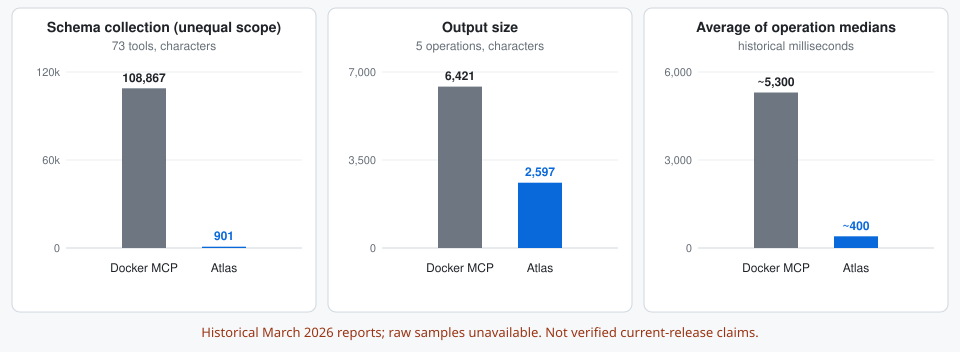

# Benchmark protocol

For live Jira and Confluence measurements and command coverage, see the
[Atlas and Atlassian CLI comparison](ACLI.md).

The March 2026 reports are historical records with missing raw evidence. They
describe one ephemeral Docker MCP configuration and measure reported characters
and tool execution times. See the [latency](LATENCY.md), [output](OUTPUT.md), and
[schema](SCHEMA.md) notes for the limits of those observations.

[](LATENCY.md)

## Prepare a shared workload

Use a test Atlassian site containing public synthetic content. Cover short/long
issues, comments, constrained searches, transitions, and Confluence pages with
code and tables. Compare the same resources, fields and result limits. List
features/fields intentionally omitted by each method. Review output preservation
before interpreting size or speed: dropped code or missing rows are failures.

Copy `cases.example.json` to a local cases file and replace all placeholders.
Add cases for your workload; the example is not a complete five-operation suite.
`cli` contains arguments after the atlas executable. Set `expect_cli` and
`expect_mcp` to known content that successful responses must contain. These checks
catch obvious wrong/empty responses; they do not prove full semantic equivalence.
Inspect and retain the actual captures separately.

## Latency

From the repository root, after installing/configuring Atlas and Docker MCP:

```bash
python benchmarks/benchmark_latency.py --cases /path/to/cases.json \
  --server YOUR_SERVER --server-version YOUR_IMAGE_DIGEST \
  --mode ephemeral --output /tmp/atlas-ephemeral.json
python benchmarks/benchmark_latency.py --cases /path/to/cases.json \
  --server YOUR_SERVER --server-version YOUR_IMAGE_DIGEST \
  --mode persistent --output /tmp/atlas-persistent.json
```

Use `--cli-only` to run without Docker. `--atlas` selects an explicit executable.
Use `--compare-cli acli` or `--compare-cli twg` to include another CLI. In each
case, add `compare_cli` with arguments for that executable and
`expect_compare_cli` with required content. For example, this case compares the
same issue and requested fields using Atlas and ACLI.

```json
[
  {
    "name": "Jira issue summary and status",
    "cli": ["jira", "get", "DEMO-1", "--fields", "key,summary,status"],
    "expect_cli": ["DEMO-1", "Synthetic design task", "In Progress"],
    "compare_cli": ["jira", "workitem", "view", "DEMO-1", "--fields", "key,summary,status", "--json"],
    "expect_compare_cli": ["DEMO-1", "Synthetic design task", "In Progress"]
  }
]
```

```bash
python benchmarks/benchmark_latency.py --cases /path/to/cases.json \
  --cli-only --compare-cli acli --output /tmp/atlas-acli.json
```

For a three-way comparison, supply `mcp_tool`, `mcp_args`, and `expect_mcp` for
each case, drop `--cli-only`, and add the persistent MCP options from above.
Match the resource, fields, and limits across all three methods. Report success
counts and HTTP request counts alongside latency when request instrumentation
is available. Keep local `--help` and `--version` timings separate from
authenticated work.

Default: 2 warm-up calls, then 30 successful samples per
operation/method. Methods rotate positions on successive iterations. Both
Docker modes reuse one gateway; persistent mode adds `--long-lived`. Gateway
initialization and warm-up are outside the measured distribution. This does not
measure cold startup; benchmark that separately if it is part of the claim.

Nonzero CLI exits, timeouts, JSON-RPC errors, MCP `isError`, empty outputs and
missing expected content fail the run. A failed run exits nonzero, preserves
partial samples with `status: failed`, and produces no comparison summary. Only
publish runs marked `complete`; do not silently discard failed runs. Publish the
number of attempted/failed runs alongside successful distributions.

Results include UTC time, platform, Python/Atlas/Docker versions, server version
label, commands/cases, all warm-up/measured samples, output hashes, median and
nearest-rank p95. Retain the server image digest and Docker Desktop/gateway version,
CPU/memory, network region, server configuration and commit in a companion record.
The script records a supplied server label; it does not verify the deployed digest.
Commands, cases and expected strings may identify private resources: review before
publishing. API tokens and full output bodies are not saved by the timing runner.

These are subprocess and gateway tool-call durations, excluding agent scheduling,
shell sandbox overhead and model inference. Do not label them end-to-end agent
latency. Do not infer individual container/protocol phase costs from total timings.

## Local Mermaid rendering

Compare clean Atlas source checkouts using the same Python environment, Mermaid
CLI on `PATH`, and Chrome or Chromium executable. The runner generates two
four-diagram Markdown documents. One repeats two diagram sources, and the
other uses four distinct sources. Each run starts a new Atlas process and times
`conf publish --dry-run --json`, including browser-backed PNG rendering.

```bash
git worktree add --detach /tmp/atlas-mermaid-before d804821
python -m benchmarks.benchmark_mermaid \
  --baseline /tmp/atlas-mermaid-before \
  --browser /path/to/chrome \
  --output /tmp/atlas-mermaid.json
```

The runner alternates execution order and uses one warm-up pair and ten
measured pairs per workload by default. It counts render starts from Atlas
stderr and checks that each preview preserves four image references and lists
the attachments those references use. The candidate must reuse one attachment
per identical source. The runner compares preview structure with attachment
filenames replaced and records exact JSON equality separately. The browser can
produce different PNG bytes when rerendering the same source, which changes
the content-addressed filenames. The measured path is local and requires no
Atlassian credentials.

On November 9, 2026 (Pacific time), an Apple M3 Max running Mermaid CLI 12.2.0
and Chrome 156.0.8078.80 produced the following offline preview timings.

| Document | Baseline p50 / p95 (s) | With reuse p50 / p95 (s) | Renderer starts |
| --- | ---: | ---: | ---: |
| Four blocks, two repeated sources | 3.247 / 3.341 | 1.677 / 1.690 | 4 → 2 |
| Four distinct sources | 3.456 / 3.558 | 3.457 / 3.498 | 4 → 4 |

All 20 measured pairs passed the structure and reference checks. Exact JSON
matched in 5 of 10 repeated-source pairs and 6 of 10 distinct-source pairs.
The [raw report](results/mermaid-render-reuse-2026-11-09.json) includes both
source revisions, render counts, and individual timings.

## Output size

Save the exact successful Atlas/MCP outputs for the same synthetic cases. Include
raw API captures only when the same operations have that baseline. Define whether
captures include tool envelopes; apply that boundary consistently. A manifest,
with paths relative to itself, looks like:

```json
[
  {
    "name": "Issue details",
    "expected": ["DEMO-1", "Known summary", "Required description"],
    "files": {"atlas": "atlas.txt", "mcp": "mcp.txt", "raw": "raw.json"}
  }
]
```

```bash
python benchmarks/benchmark_output.py /path/to/manifest.json > /tmp/output-counts.json
# Optional: install tiktoken into your benchmark environment first.
python benchmarks/benchmark_output.py /path/to/manifest.json \
  --encoding cl100k_base > /tmp/output-token-counts.json
```

The tool counts exact UTF-8 bytes and Unicode characters, validates required text,
and hashes captures. Optional token counts include the tokenizer library/version
and encoding. Choose the encoding appropriate for the evaluated model. No token
estimate is generated from character counts. Reduction is `1 - atlas / baseline`,
computed from totals over the same cases; negative values mean Atlas is larger.
Required-string checks supplement human review of code, links, tables, comments
and pagination; they cannot establish complete content preservation.

Commit reviewed synthetic captures, manifests, raw result JSON, provenance and the
exact commands before publishing new numbers. Do not fabricate MCP captures or
present mocked responses as measured server performance.

## Agent context

Schema collection size is not actual context use. For an agent-level comparison,
fix the agent/model version, task and configuration, and include routing rules,
CLI help discovery, loaded schemas, invocation arguments and result envelopes.
Report individual tasks and actual tokenizer/request accounting. Distinguish peak
context from cumulative input tokens, and disclose caching/compaction. Until such
runs exist, make no “X times less context” claim.
